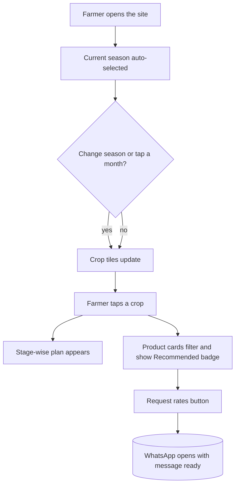

<div align="center">

```text
      🌾      🌱      🌽      🥜      🍅      🌶️      🍌
  ═══════════════════════════════════════════════════════
       S E A S O N   ·   C R O P   ·   P R O D U C T
  ═══════════════════════════════════════════════════════
```

# 🌾 Annapoorna Agro Centre

**A modern website for an agri inputs and pump dealer. Farmers pick a season and a crop, see a stage-by-stage plan, and get the right seeds, fertilizers, pumps and drip products. Then they send an enquiry straight to your WhatsApp.**


[**▶ Live Preview**](https://claude.ai/artifact/AZLv4FwVuhA9nEo1vx4CmK) · [**Report an Issue**](../../issues)

</div>

---

## 🧑‍🌾 Why This Site Exists

Farmers rarely walk in knowing the exact product name. They know their **crop**, their **stage** and their **problem**. This site starts from that, so it works like the advice you would give at the counter, but available 24 hours a day on a phone.

## ✨ Highlights

| | Feature | What it does |
|---|---|---|
| 🗓️ | **Season calendar strip** | 12-month bar colour-coded by season, with today's month marked. Tap a month to jump to that season |
| 🌱 | **Crop tiles** | Big tappable tiles. The list changes with the season selected |
| 📋 | **Stage-wise plan** | Four steps per crop, from sowing to harvest, listing what to buy at each stage |
| 🛒 | **Smart product filter** | The six product cards filter to the selected crop and show a "Recommended for…" badge |
| 💧 | **Pump finder** | Enter water source, depth and acres to get a starting HP and pump type |
| 💬 | **WhatsApp enquiry** | Quote form sends product, crop, name and village to your number |
| 🟢 | **Live Open/Closed badge** | Based on your shop timings in Indian time |
| 📱 | **Mobile first** | Bottom call and WhatsApp bar, light and dark themes |

## 📅 The Almanac

```text
 Jan  Feb  Mar  Apr  May  Jun  Jul  Aug  Sep  Oct  Nov  Dec
 ┌────┬────┬────┬────┬────┬────┬────┬────┬────┬────┬────┬────┐
 │ 🟧 │ 🟧 │ 🟧 │ 🟩 │ 🟩 │ 🟦 │ 🟦 │ 🟦 │ 🟦 │ 🟦 │ 🟧 │ 🟧 │
 └────┴────┴────┴────┴────┴────┴────┴────┴────┴────┴────┴────┘
   🟦 Kharif (Jun–Oct)   🟧 Rabi (Nov–Mar)   🟩 Zaid (Apr–May)
```

### Crop × Season Matrix

| Crop | Kharif | Rabi | Zaid |
|---|:-:|:-:|:-:|
| 🌾 Paddy | ✅ | ✅ | |
| 🥜 Groundnut | ✅ | ✅ | ✅ |
| 🌽 Maize | ✅ | ✅ | |
| ☁️ Cotton | ✅ | | |
| 🍅 Tomato | ✅ | ✅ | |
| 🌶️ Chilli | ✅ | ✅ | |
| 🎋 Sugarcane | | ✅ | ✅ |
| 🍌 Banana | ✅ | ✅ | ✅ |

## 🔀 How the Filter Works



## 🛒 Product Catalogue

| Category | Covers |
|---|---|
| **Certified Seeds** | Hybrid and open-pollinated seed, seed treatment, vegetable seed and nursery trays |
| **Fertilizers** | Urea, DAP, complex, potash, water-soluble grades, micronutrients, gypsum |
| **Crop Protection** | Insecticides, fungicides, herbicides, bio-pesticides, safety gear |
| **Pumps and Motors** | Submersible, monoblock and open-well pumps, panels, cables and spares |
| **Drip and Sprinklers** | Drip lines, filters, sprinklers and fittings |
| **Sprayers and Farm Tools** | Sprayers, pipes, tarpaulins, crates and hand tools |

## 💧 Pump Finder Logic

The finder gives a **starting suggestion** only. The shop confirms the exact model.

**Borewell** (by depth to water):

| Depth | Suggested size |
|---|---|
| Up to 100 ft | 1 HP |
| 101 to 200 ft | 2 HP |
| 201 to 300 ft | 3 HP |
| 301 to 450 ft | 5 HP |
| Above 450 ft | 7.5 HP or more |

**Open well and canal or farm pond** (by land area):

| Land | Suggested size |
|---|---|
| Up to 2 acres | 1 HP |
| 2 to 5 acres | 2 HP |
| 5 to 10 acres | 3 HP |
| Above 10 acres | 5 HP |

> ⚠️ Indicative only. Real selection also depends on yield, pipe size and power supply.

## ⚙️ Set Up in 4 Steps

**1. Shop details**: edit the `CFG` block at the top of the script.

```js
const CFG = {
  name:  "Your Agro Centre",
  tag:   "Seeds • Fertilizers • Pumps • Drip",
  owner: "Owner Name",
  phone: "+91 98765 43210",
  wa:    "919876543210",          // country code + number, no + or spaces
  email: "you@example.com",
  addr:  "Market Road, Town, State",
  areas: ["Town", "Nearby Villages"],
  hours: { 0:[7,13], 1:[7,20], 2:[7,20], 3:[7,20], 4:[7,20], 5:[7,20], 6:[7,20] }
};
```

`hours` uses day numbers (0 = Sunday) with `[opening hour, closing hour]` in 24-hour format.

**2. Crops**: edit the `CR` array. Each crop is one entry:

```js
["Paddy", "🌾", ["Kharif","Rabi"], [
  ["Stage name", "What to buy at this stage"],
  /* four stages in total */
]]
```

**3. Products**: edit the `PR` array. The sixth value is the list of crops the product is recommended for, or `null` to show it for every crop:

```js
["Title", "Tag", "Spec line", "Description", ["Feature 1"], ["Paddy","Maize"], "Best for text"]
```

**4. Seasons**: months and notes live in the `SEA` object. Adjust them to match your region's local cropping calendar.

## 🎨 Colours

```css
--g:  #0d3b5c;   /* deep water blue */
--ac: #ff9f1c;   /* mango orange */
```

## 🚀 Go Live Free

| Platform | How |
|---|---|
| 🐙 **GitHub Pages** | Settings → Pages → Deploy from `main` |
| 🟢 **Netlify** | Drag and drop the folder |
| ▲ **Vercel** | Import the repository |

Tip: list the shop on **Google Business Profile** with this website link so farmers nearby can find you.

## ✅ Pre-Launch Checklist

- [ ] Shop name, phone, WhatsApp, email and address updated
- [ ] Villages and towns you serve listed
- [ ] Timings correct and Open/Closed badge checked
- [ ] Crop plans reviewed by a local agriculture officer or your experienced staff
- [ ] Product list matches what you actually stock
- [ ] Pump finder suggestions checked against your own experience
- [ ] Quote form and pump button tested: WhatsApp opens with the message
- [ ] Opened on a low-end phone

## 🛠️ Fault Finding

| Problem | Likely cause | Fix |
|---|---|---|
| WhatsApp opens empty | Wrong `wa` format | Use country code and number only, such as `919876543210` |
| Wrong season shown as current | Local calendar differs | Adjust months in `SEA` |
| A crop is missing from a season | Season not listed for it | Add the season to the crop's season array in `CR` |
| A product shows for every crop | Crop list is `null` | Give that product a list of crops in `PR` |

<details>
<summary><b>❓ FAQ</b></summary>

**Is the crop advice a replacement for an expert?** No. The plans are general guidance. Doses and sprays depend on soil, variety and pest pressure, so farmers should follow a soil test and local agriculture officer advice. The site says this on the page.

**Can I add more crops?** Yes. Add one entry to `CR` with its seasons and four stages.

**Does it need a server?** No. It is a single HTML file.

</details>

## 🗺️ Roadmap

- [x] Season calendar and crop tiles
- [x] Stage-wise crop plans
- [x] Pump finder
- [x] WhatsApp enquiry flow
- [ ] Product photos and price list
- [ ] Tamil and Hindi language switch
- [ ] Seasonal offers strip
- [ ] Soil and weather tips
- [ ] Farmer reviews section

## 🤝 Contributing

Fork the repo, create a branch, make your change and open a pull request.

## 📄 License

Released under the MIT License.

<div align="center">

**From the first seed to the last drop of water.** 🌾

</div>
